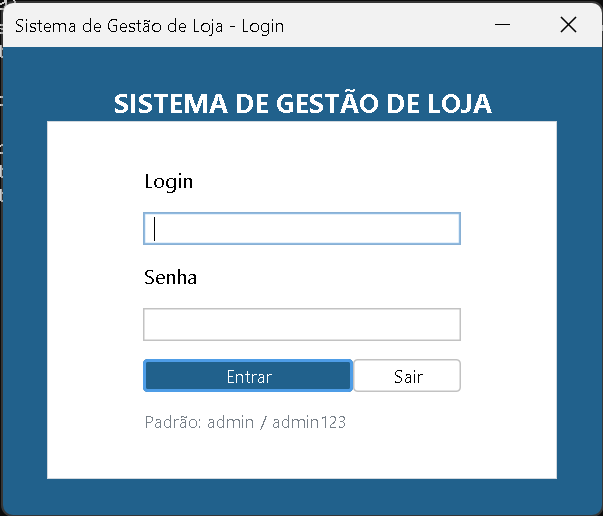
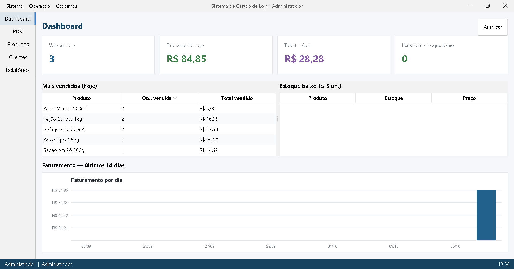
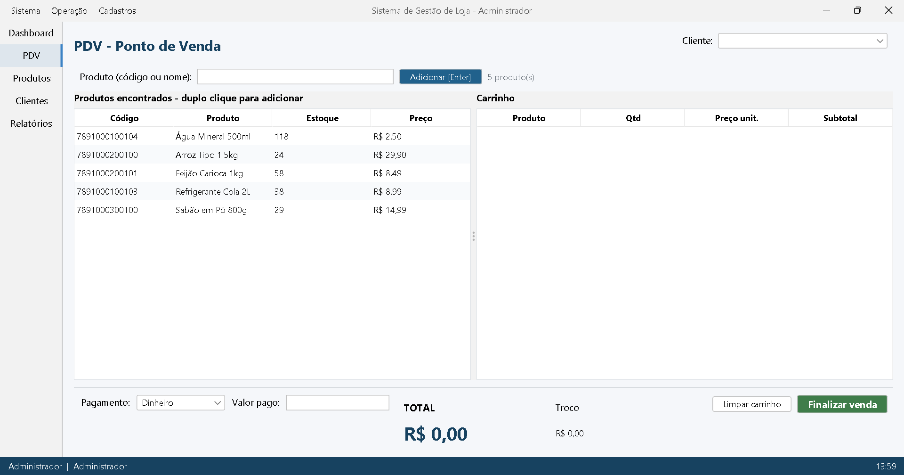
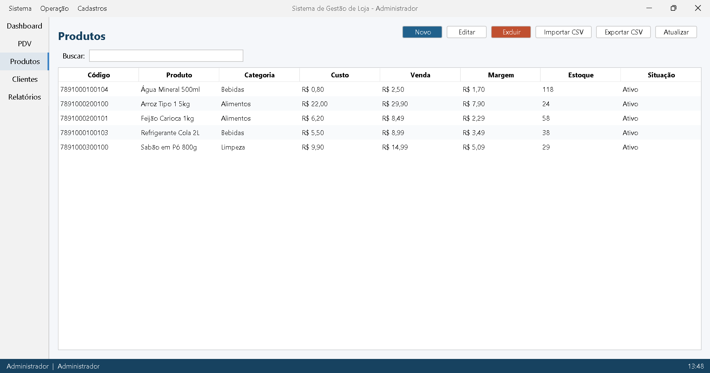
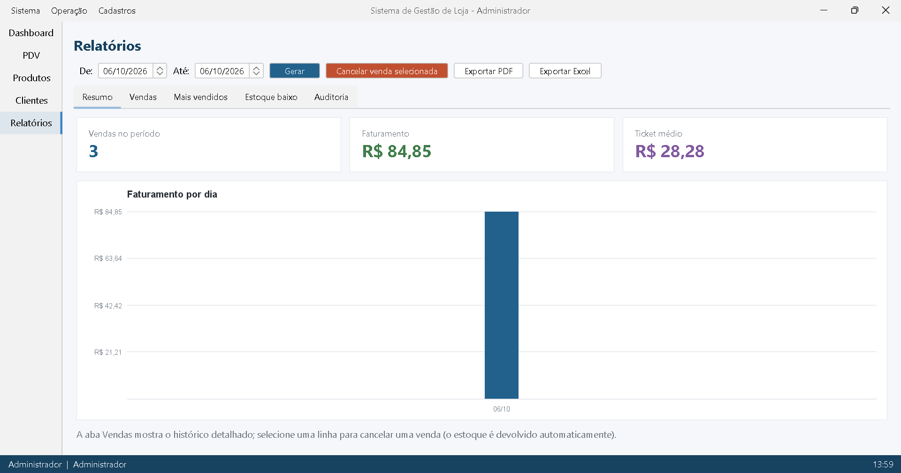

# Sistema de Gestão de Loja / PDV

[](https://github.com/EduardoAlvez/sistema-loja/actions/workflows/ci.yml)
[](LICENSE)

Sistema completo de gestão de loja com **PDV (ponto de venda)** em **Java Desktop (Swing)** e **MySQL**,
desenvolvido como projeto de portfólio para demonstrar arquitetura em camadas, JDBC puro,
regras de negócio e testes automatizados.

---

## Telas

| Login | Dashboard |
|-------|-----------|
|  |  |

| PDV | Produtos |
|-----|----------|
|  |  |

| Relatórios |
|------------|
|  |

---

## Funcionalidades

### Acesso
- **Login** com perfis distintos: **Administrador** e **Operador de caixa**
- Senhas armazenadas com **SHA-256 + salt por usuário** e comparação *constant-time*
- Operador não acessa o gerenciamento de usuários

### Dashboard
- Cards de **vendas do dia**, **faturamento**, **ticket médio** e **itens com estoque baixo**
- Tabelas de **produtos mais vendidos** e **estoque crítico** (≤ 5 un.)
- **Gráfico de faturamento dos últimos 14 dias** logo abaixo das tabelas, com tooltip por dia

### PDV (Ponto de Venda)
- Busca por **código de barras** (Enter adiciona direto) ou **nome**, com duplo clique
- **Carrinho editável**: quantidade alterável na própria tabela, itens duplicados são somados
- **4 formas de pagamento**: dinheiro, débito, crédito e PIX, com **cálculo de troco** em tempo real
- **Desconto no total ou por item**, limitado pelo perfil do operador (10%) ou do administrador (50%)
- **Fidelidade por pontos**: o cliente selecionado mostra o **saldo de pontos**, o operador digita
  quantos pontos resgatar e o desconto entra no total na hora, respeitando o limite do perfil
- **Crédito de pontos** por venda, **extrato de pontos** do cliente e **estorno** em devolução
  parcial ou cancelamento
- **Pagamento dividido**: a mesma venda pode ser paga em mais de uma forma, com troco só no dinheiro
- **Pausa e retomada** de venda em andamento (o carrinho fica guardado com a forma de pagamento)
- **Reimpressão do último cupom** do operador logado
- Seleção de cliente opcional e **cupom não fiscal** gerado no fim da venda
- **Cupom térmico de 80mm** com **QR Code PIX** (BR Code oficial, com valor e CRC16), opção de salvar em `.txt` e **impressão ESC/POS** (corte, negrito e gaveta) pela fila do sistema
- **Promoções com vigência**: preço promocional por período, dia da semana e horário
  (happy hour), aplicado automaticamente no carrinho
- **Devolução parcial** com crédito no cliente e estorno de estoque
- Baixa de estoque **transacional** (commit/rollback) e validação de estoque antes de vender
- **Atalhos F3 a F12**: buscar, dividir, pausar, retomar, reimprimir, limpar, sangria, suprimento,
  abrir caixa e finalizar — além do atalho **F2** (menu Operação) que abre o PDV de qualquer tela

### Caixa
- **Abertura de caixa** com valor inicial e um caixa aberto por vez
- **Sangria e suprimento** lançados no caixa aberto, com saldo em espécie calculado na hora
- **Fechamento com relatório do dia**: total de vendas por forma de pagamento, lançamentos e saldo
- O caixa é um **controle financeiro independente**: vender não exige um caixa aberto

### Cadastros
- **Produtos**: código de barras único, categoria, preço de custo/venda, margem calculada,
  estoque, **estoque mínimo**, situação ativo/inativo e **promoção** com preço, vigência,
  dias da semana e faixa de horário
- **Alerta de estoque mínimo**: aviso com a quantidade de itens críticos e destaque na tabela,
  com filtro **“Somente estoque baixo”** e **filtro por categoria**
- **Importação/exportação em CSV** (UTF-8 com BOM, separador `;`): valida linha a linha,
  importa o que é válido, reporta o que não é e grava **um único evento de auditoria**
- **Clientes**: CPF com **validação real de dígitos verificadores**, e-mail, crédito de devolução,
  busca e exclusão
- **Saldo de pontos** na listagem de clientes e **extrato de pontos** (créditos, resgates e estornos)
  em diálogo próprio
- **Usuários** (somente admin): criação com perfil, validação de senha e **comissão percentual**

### Relatórios
- Período livre (de/até) com **vendas, faturamento e ticket médio**
- Histórico de vendas com status e **cancelamento de venda com devolução automática de estoque**
- **Mais vendidos** do período e lista de **estoque baixo**
- **Resumo por operador** com total vendido e **comissão** calculada pelo percentual do usuário
- **Gráfico de faturamento por dia** (barras desenhadas com `Graphics2D`, sem biblioteca externa),
  com tooltip ao passar o mouse sobre cada barra
- **Aba Auditoria** (somente admin): trilha de ações do sistema no período

### Exportação
- **PDF** (OpenPDF): relatório com resumo, **gráfico de faturamento por dia**, tabela de vendas,
  mais vendidos, zebra de linhas, destaque para vendas canceladas e número de página no rodapé
- **Excel .xlsx** (Apache POI): 3 abas (`Resumo`, `Vendas`, `Mais vendidos`) com cabeçalho
  destacado, moeda formatada, largura de colunas e painéis congelados
- Nome de arquivo sugerido com o período (`relatorio_vendas_2026-10-01_a_2026-10-06.pdf`)
  e caixa de diálogo para escolher onde salvar

### Confiabilidade e governança
- **Logs** em `logs/sistema-loja.log` (rotação 5 MB × 3) e console via **Log4j2**:
  erros inesperados da interface guardam a stack trace completa, junto de ações como
  login, vendas, cancelamentos e exportações
- **Migrações de banco com Flyway** (`V1` a `V15`: esquema, auditoria, desconto, caixa,
  pagamentos, vendas pausadas, devoluções, comissão, estoque mínimo, promoções e pontos), com histórico
  consultável e `baseline` automático para bancos já existentes
- **Trilha de auditoria** (tabela `auditoria`, append-only): login ok/falha, venda
  registrada/cancelada, devolução, crédito/resgate/estorno de pontos, produto/cliente salvos,
  comissão definida e usuário criado — com usuário, data/hora e detalhe; nunca grava senha

---

## Como executar

### Pré-requisitos
- **JDK 21** ou superior
- **Maven 3.9+**
- **Docker** (mais fácil) ou um **MySQL 8** local

### 1. Subir o banco de dados

```bash
docker compose up -d
```

> Já tem o container antigo (`docker run`)? Remova-o antes: `docker rm -f mysql-sistema-loja`.
> Os dados vivem no volume `mysql-data`; numa máquina nova o banco começa com o seed de exemplo.

O esquema é versionado com **Flyway** (`src/main/resources/db/migration`) e os dados de
exemplo entram na primeira execução. Bancos criados antes do Flyway recebem `baseline`
automático — nada de reaplicar DDL em cima de dados.

```bash
# histórico de migrações (opcional)
mvn flyway:info -Dflyway.url=jdbc:mysql://localhost:3306/sistema_loja \
  -Dflyway.user=root -Dflyway.password=root
```

### 2. Executar

```bash
mvn clean package
java -jar target/sistema-loja-1.1.0.jar
```

Ou pela IDE: execute a classe `com.portfolio.sistemaloja.App`.

Também é possível baixar o jar pronto na página de
[Releases](https://github.com/EduardoAlvez/sistema-loja/releases).

### Formas de implantação

O aplicativo é um **cliente de banco de dados**: ele abre a conexão e aplica as migrações do
Flyway **antes** de exibir o login. O banco precisa existir em algum lugar — e **Docker é só a
opção mais rápida para desenvolvimento, não um requisito da loja**.

| Cenário | Banco | Como |
|---------|-------|------|
| Desenvolvimento | MySQL 8 em container | `docker compose up -d` (este repositório) |
| Um caixa | MySQL 8 no próprio PC | instalador oficial como **serviço do Windows** (sobe com o PC), sem Docker |
| Várias lojas/terminais | MySQL 8 num servidor | um banco só na rede; cada caixa aponta `DB_URL` para ele |
| Balcão sem banco instalado | H2 **em arquivo** | *planejado*: banco embarcado junto da pasta de dados do app (roadmap) |

Como a configuração é sempre `DB_URL`, `DB_USER` e `DB_PASS`, sair do container para um
**serviço do Windows** ou para um **servidor** não muda uma linha de código — só a variável.

> O banco em arquivo (H2) aceita **um processo por vez**: serve para um caixa. Para vários
> terminais no mesmo banco, use MySQL ou o modo servidor do H2. O backup passa a ser copiar
> o arquivo de dados.
>
> Sem JDK na máquina do balcão? O caminho é empacotar com **`jpackage`** (JRE embutida) —
> também no roadmap. Hoje é necessário ter o **JDK 21** instalado.
>
> O `docker-compose.yml` ainda usa `mysql:8.0`, que chegou ao **EOL em abril/2026**; para
> novas instalações o alvo é o **MySQL 8.4 LTS** (no roadmap).

### Credenciais padrão

| Perfil | Login | Senha |
|--------|-------|-------|
| Administrador | `admin` | `admin123` |
| Operador de caixa | `operador` | `caixa123` |

### Configuração por variáveis de ambiente (opcional)

| Variável | Padrão |
|----------|--------|
| `DB_URL` | `jdbc:mysql://localhost:3306/sistema_loja?useSSL=false&allowPublicKeyRetrieval=true&serverTimezone=UTC` |
| `DB_USER` | `root` |
| `DB_PASS` | `root` |

### Configuração do PIX (opcional)

O QR Code do cupom térmico usa a chave PIX configurada por variável de ambiente ou propriedade:

| Variável | Propriedade | Padrão |
|----------|-------------|--------|
| `PIX_CHAVE` | `-Dpix.chave` | `pagamentos@lojaexemplo.com.br` |
| `PIX_NOME` | `-Dpix.nome` | `LOJA EXEMPLO LTDA` |
| `PIX_CIDADE` | `-Dpix.cidade` | `SAO PAULO` |

### Impressora térmica ESC/POS (opcional)

O botão **Cupom 80mm (PIX)** abre o diálogo com a prévia de texto e permite **Salvar .bin**
(bytes ESC/POS prontos) ou **Imprimir** direto na fila de impressão do sistema. Não é preciso
instalar driver do fabricante: cadastre a impressora no Windows como **Generic / Text Only**
(porta USB ou de rede) e selecione essa fila no diálogo.

| Variável | Propriedade | Padrão |
|----------|-------------|--------|
| `IMPRESSORA_NOME` | `-Dimpressora.nome` | vazio (primeira fila instalada) |
| `IMPRESSORA_CODEPAGE` | `-Dimpressora.codepage` | `2` (Cp850); use `16` para Windows-1252 |
| `IMPRESSORA_QR_MODULO` | `-Dimpressora.qr.modulo` | `4` (1 a 16, quanto maior o QR, maior o cupom) |

- Acentos saem conforme a **codepage** escolhida: se aparecerem trocados, alterne entre `2` e `16`.
- O corte é o **último comando** do cupom; a **gaveta** abre antes do corte quando o pagamento
  inclui dinheiro (inclusive no pagamento dividido).
- Sem impressora instalada, use **Salvar .bin** e envie em modo bruto:
  `copy /b "cupom-80mm.bin" \\localhost\NOME_DA_FILA`.
- Em rede, confirme que a fila aponta para a porta **9100** da impressora (ou use o nome compartilhado).

### Promoções

O cadastro de produto aceita um **preço promocional** com critérios opcionais:

- **Vigência**: data de início e fim, ambas inclusivas; vazio = sem limite.
- **Dias da semana**: nenhum marcado = todos os dias.
- **Horário**: início e fim no mesmo dia (`18:00` a `20:00`); vazio = dia inteiro.

Regras aplicadas na venda:

- O PDV mostra **Ativa** na coluna Promoção e coloca o **preço vigente** no carrinho; ao
  re-adicionar o mesmo produto, o preço é recalculado.
- O preço promocional é preço de loja e **não consome o limite de desconto manual** do perfil;
  o limite é calculado sobre o preço vigente.
- Cadastro inconsistente (preço promocional maior ou igual ao de venda, datas invertidas,
  apenas um horário, promoção sem preço) é recusado.
- O **CSV de produtos continua com 7 colunas**; promoções são editadas na tela de cadastro.

### Fidelidade por pontos

O cliente acumula **1 ponto por real** em cada venda e pode resgatar pontos como desconto no PDV.

| Variável | Propriedade | Padrão |
|----------|-------------|--------|
| `FIDELIDADE_PONTOS_POR_REAL` | `-Dfidelidade.pontosPorReal` | `1` |
| `FIDELIDADE_VALOR_PONTO` | `-Dfidelidade.valorPorPonto` | `0.05` |

Regras aplicadas:

- **Crédito**: `floor(total da venda × pontos por real)`, calculado sobre o **total final** (já com
  descontos e resgates) — nunca sobre o valor pago (o troco não gera pontos).
- **Resgate**: o PDV envia só a **quantidade de pontos**; o serviço converte para dinheiro e grava
  em `venda.valorPontos` (o `venda.desconto` é sempre o desconto manual, o total é
  `itens - desconto - valorPontos`), então o resgate **respeita o limite de desconto do perfil**
  (desconto manual + pontos + descontos de item).
- O resgate não pode zerar o total da venda, um resgate que não gere desconto é recusado e o saldo
  do cliente é debitado **na mesma transação** da venda (o crédito da venda para no mesmo extrato).
- **Devolução parcial**: estorna a parte proporcional dos pontos creditados, calculada sobre a
  **mercadoria devolvida acumulados** em relação à mercadoria vendida (devolver 25% da mercadoria
  estorna 25% dos pontos; devolver tudo em várias devoluções estorna o mesmo que devolver tudo de
  uma vez), limitado ao que ainda não foi estornado e nunca acima dos pontos creditados;
  **cancelar a venda** estorna todo o crédito e devolve os pontos resgatados.
- **Regra conhecida (produto)**: na devolução os pontos **resgatados** não voltam ao cliente (só no
  cancelamento) e o crédito do cliente é o valor da mercadoria devolvida.
- A trilha de auditoria e o extrato registram os pontos **efetivamente** estornados, e a devolução
  guarda o quanto estornou em `devolucoes.pontos_estornados`.
- Saldo e estornos ficam registrados no **extrato de pontos** (crédito, resgate, estorno de crédito
  e devolução de resgate) e na **trilha de auditoria**.

### Testes

```bash
mvn test
```

**255 testes** cobrindo serviços, validações, senhas, o ciclo completo de venda (pagamento
dividido, desconto, caixa, pausa, devolução e comissão), o cupom térmico com **PIX BR Code**
e QR Code decodificado no teste, a **impressão ESC/POS com impressora em memória** (QR nativo,
corte e gaveta), a exportação em PDF/Excel, o gráfico, o CSV de produtos,
as **promoções com vigência, dias e horários**, a **fidelidade por pontos** (crédito, resgate,
saldo, extrato e estornos), as migrações do Flyway e a trilha de auditoria —
rodam sobre **H2 em modo MySQL**, ou seja, não dependem do Docker.

---

## Arquitetura

Projeto em **quatro camadas**, com dependência sempre de cima para baixo:

```
┌──────────────────────────────────────────────────────┐
│ ui/          Swing: telas, diálogos e formulários    │
├──────────────────────────────────────────────────────┤
│ service/     Regras de negócio e validações          │
├──────────────────────────────────────────────────────┤
│ repository/  JDBC: SQL, mapeamento e transações      │
├──────────────────────────────────────────────────────┤
│ model/       Entidades e enums                       │
│ db/          Conexão, migração e hash de senhas      │
└──────────────────────────────────────────────────────┘
```

| Camada | Pacote | Responsabilidade |
|--------|--------|------------------|
| UI | `ui` | `TelaLogin`, `TelaPrincipal` com abas, painéis e diálogos |
| Serviço | `service` | `VendaService`, `ProdutoService`, `ClienteService`, `CaixaService`, `PausaService`, `DevolucaoService`, `UsuarioService`, `CupomService`, `CupomTermicoService` (+ `PixPayload`, `QrAscii`), `RelatorioService`, `AuthService`, `AuditoriaService`, `Cpf` |
| Impressão | `impressao` | `EscPos`, `CupomEscPosService`, `ImpressaoCupomService`, `ImpressoraConfig`, `ImpressorasSpool` (+ `ImpressoraSpool`) |
| Repositório | `repository` | `ProdutoRepository`, `VendaRepository`, `VendaPausadaRepository`, `DevolucaoRepository`, `CaixaRepository`, `ClienteRepository`, `UsuarioRepository`, `CategoriaRepository`, `RelatorioRepository`, `AuditoriaRepository` |
| Modelo | `model` | `Produto`, `Cliente`, `Venda`, `VendaItem`, `VendaPagamento`, `Caixa`, `Devolucao`, `Usuario`, enums |
| Infra | `db` | `Banco` (fonte de conexão), `Migrador` (Flyway + seed), `Senhas` |

A interface recebe uma única instância de `Aplicacao`, que monta toda a árvore de dependências —
a mesma classe é usada pelos testes apontando para o H2.

---

## Estrutura do projeto

```
sistema-loja/
├── pom.xml                                  # Build Maven (Java 21, shade + exec)
├── src/
│   ├── main/
│   │   ├── java/com/portfolio/sistemaloja/
│   │   │   ├── App.java                     # Ponto de entrada: FlatLaf + migração + login
│   │   │   ├── Aplicacao.java               # Composição das dependências (DI manual)
│   │   │   ├── Sessao.java                  # Usuário logado (contexto da auditoria)
│   │   │   ├── db/                          # Banco, Migrador (Flyway), Senhas, ConexaoFonte
│   │   │   ├── grafico/                     # GraficoFaturamento: render com Graphics2D
│   │   │   ├── impressao/                   # ESC/POS, QR nativo, spooler e impressora falsa
│   │   │   ├── model/                       # Produto, Cliente, Venda, Usuario, enums
│   │   │   ├── repository/                  # Repositórios JDBC + records de relatório
│   │   │   ├── service/                     # Regras de negócio e validações
│   │   │   └── ui/                          # Classes Swing (telas, painéis, diálogos)
│   │   └── resources/
│   │       ├── db/migration/                # V1 a V15 (esquema, caixa, PIX, estoque mínimo, promoções, pontos)
│   │       └── log4j2.xml                   # Logs: console + arquivo com rotação
│   └── test/java/com/portfolio/sistemaloja/ # 255 testes JUnit 5
└── target/                                  # Build (ignorada no git)
```

---

## Tecnologias

- **Java 21** + **Swing** (interface desktop)
- **FlatLaf 3.5** (visual moderno nativo do Swing)
- **Gráficos com `Graphics2D`** da própria JDK (nenhuma dependência de biblioteca de charts)
- **MySQL 8** via **mysql-connector-j** (JDBC puro, sem ORM)
- **Flyway** (migrações versionadas do esquema, com baseline para bancos existentes)
- **Log4j2** (logs em arquivo com rotação e no console)
- **H2** no modo MySQL (banco dos testes)
- **ZXing core 3.5** (QR Code PIX do cupom térmico, gerado como texto para impressão)
- **`javax.print`** da JDK (envio dos bytes ESC/POS para a fila do sistema, sem driver do fabricante)
- **Apache POI 5.5** (exportação em `.xlsx`) + **OpenPDF 3** (exportação em PDF)
- **JUnit 5** + Maven Surefire
- **Maven Shade** (jar executável único)

---

## Notas de implementação

- **Venda em transação**: `VendaRepository.registrar()` faz `commit` da venda + itens + baixa de
  estoque juntos; qualquer falha (ex.: estoque insuficiente) dispara `rollback` e nada é gravado.
- **Estoque protegido no SQL**: `UPDATE produtos SET estoque = estoque + ? WHERE ... AND estoque + ? >= 0`,
  ou seja, a proteção contra corrida entre caixas está no próprio banco.
- **Cancelamento devolve estoque**: mesma transação, e a venda fica registrada com status `CANCELADA`
  para manter a trilha de auditoria (nunca é apagada).
- **Migrações versionadas**: esquema no Flyway (`V1` esquema inicial até `V15` fidelidade);
  bancos já existentes recebem `baselineOnMigrate`, então o histórico nasce sem reaplicar DDL.
  O seed continua idempotente (só roda se a tabela `usuarios` estiver vazia).
- **PIX BR Code na mão**: `PixPayload` monta o payload EMV campo a campo (incluindo o
  **CRC16-CCITT**), `QrAscii` desenha a matriz do QR Code e o `CupomTermicoService` monta o
  cupom de 80 colunas — tudo testável, com o QR **decodificado de volta** nos testes.
- **Impressão ESC/POS em bytes**: `EscPos` emite os comandos (codepage, negrito, alinhamento,
  QR nativo `GS ( k`, gaveta e corte) e `ImpressoraSpool` envia o array pelo `javax.print`;
  `ImpressoraMemoria` guarda os trabalhos nos testes, sem hardware.
- **Auditoria fora da transação**: os services gravam na trilha com `try/catch` próprio —
  se a gravação falhar, o erro vai para o log e a operação principal não é afetada.
- **Erros da interface com stack trace**: `Ui.erro(..., causa)` loga a exceção completa antes
  de mostrar a mensagem amigável; validações previstas ficam só no diálogo, sem poluir o log.
- **Números de venda sequenciais** (`V000001`, `V000002`...) com constraint de unicidade.
- **CPF de verdade**: algoritmo dos dois dígitos verificadores, rejeita sequências repetidas
  e guarda o CPF formatado (`000.000.000-00`).
- **Desconto com limite por perfil**: `VendaService.validarLimiteDescontoPorPerfil` confere o
  desconto dos itens **e** o desconto da venda contra o percentual do usuário logado
  (operador 10%, administrador 50%).
- **Devolução parcial**: só venda concluída, quantidade limitada ao que ainda não foi devolvido,
  preço da própria venda, estorno de estoque e crédito opcional na conta do cliente — tudo na
  mesma transação.
- **Ordem das regras**: o caixa tem seu próprio ciclo de vida; vender **não** exige caixa aberto,
  o que mantém PDV e financeiro independentes.
- **Sem SQL dinâmico**: todas as consultas usam `PreparedStatement`, inclusive os filtros de busca.

---

## Roadmap

- [x] Migração de esquema + dados de exemplo
- [x] Login com perfis e senha com hash
- [x] CRUD de produtos, clientes e categorias
- [x] PDV com carrinho, pagamento e cupom
- [x] Cancelamento de venda com devolução de estoque
- [x] Dashboard e relatórios por período
- [x] Gráfico de faturamento por dia (Graphics2D) na tela e no PDF
- [x] Exportação de relatórios em PDF e Excel (.xlsx)
- [x] Migrações de banco com Flyway (V1 esquema, V2 auditoria, baseline)
- [x] Logs em arquivo com rotação e stack traces da interface (Log4j2)
- [x] Trilha de auditoria com consulta na aba Relatórios (admin)
- [x] Jar executável com `mvn package`
- [x] Gráfico de faturamento dos últimos 14 dias no dashboard
- [x] Importação/exportação de produtos em CSV
- [x] Tecla de atalho F2 para o PDV
- [x] CI no GitHub Actions com badge de build
- [x] Publicar no GitHub
- [x] Telas no README e release `v1.0.0` com jar para download
- [x] Desconto no total e por item, limitado pelo perfil do operador
- [x] Movimento de caixa: abertura, sangria, suprimento e fechamento com relatório
- [x] Pagamento dividido entre formas
- [x] Pausa e retomada de venda em andamento
- [x] Reimpressão do último cupom do operador
- [x] Atalhos F3 a F12 no PDV
- [x] Devolução parcial com crédito no cliente
- [x] Relatório por operador com comissão
- [x] Cupom térmico 80mm com QR Code PIX (BR Code + CRC16)
- [x] Alerta de estoque mínimo e filtro de produtos por categoria
- [x] 255 testes JUnit (serviços, UI, migrações e integração sobre H2)
- [x] Release `v1.1.0` com jar para download
Itens levantados na pesquisa de mercado (comparação com PDVs comerciais), agrupados por esforço.

**Onda 1 — baixo esforço, alto valor**

- [x] Impressora ESC/POS (corte, negrito e comando de abrir gaveta) com impressora falsa nos testes
- [x] Promoções com vigência e preço por dia/horário (happy hour)
- [x] Fidelidade por pontos, com resgate como desconto na venda
- [ ] Autorização de supervisor por PIN (desconto acima da alçada, cancelamento e sangria)
- [ ] Conferência cega no fechamento de caixa, com a divergência registrada
- [ ] Indicadores: vendas por hora, curva ABC, giro/ruptura, produtos sem movimentação, comparativo mensal

**Onda 2 — médio esforço**

- [ ] Fornecedores, entrada de mercadoria e sugestão de compra pelo consumo real
- [ ] Inventário/contagem cíclica, perdas com motivo e transferência entre lojas
- [ ] Lote e validade com alerta de vencimento
- [ ] TEF por interface abstrata, taxa por bandeira e conciliação de cartões
- [ ] Fiado/crediário com limite, vencimento, recebimento parcial e juros
- [ ] Multi-caixa e multi-loja com preço centralizado
- [ ] Relatórios de estoque crítico usando o `estoque_minimo` de cada produto
- [ ] Subir o `docker-compose.yml` para MySQL 8.4 LTS

**Onda 3 — alto esforço**

- [ ] Modo embarcado com H2 em arquivo (rodar sem instalar banco)
- [ ] Offline-first: vender sem internet e sincronizar depois
- [ ] Instalador com `jpackage` (JRE embutida, sem JDK no balcão)
- [ ] NFC-e/SAT com certificado digital, Menu Fiscal e IBS/CBS
- [ ] Restaurante: comanda, divisão de conta, KDS e impressão setorizada
- [ ] Delivery/omnichannel: cardápio QR, totem e integrações

---

## Autor

**Eduardo Alvez** — [byteswood@gmail.com](mailto:byteswood@gmail.com)

Projeto de portfólio — Sistema de Gestão de Loja / PDV em Java Desktop.
